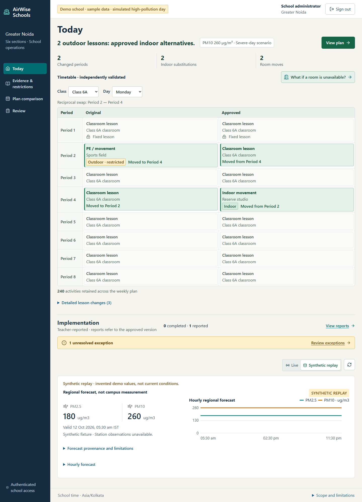

# AirWise Schools

**Reviewed restrictions. A workable timetable. A record of what happened.**

AirWise helps administrators repair a school timetable around explicitly confirmed
outdoor restrictions, teachers, rooms and fixed lessons, then track what teachers
could actually implement. This prototype uses one fictional Greater Noida school,
six sections and sample school data.

[Open the hosted app](https://main.d29v8cmldu93l3.amplifyapp.com) |
[Source code](https://github.com/Unnati061/airwise-schools)

## The Problem

School pollution advisories can recommend limiting outdoor activities. Implementing
that advice creates a scheduling problem: which room, teacher and period can
accommodate a lesson without conflicting with other classes? An approved plan also
needs follow-through when a room becomes unavailable or a teacher cannot implement it.
Pollution values alone do not confirm restrictions or activate legal orders.

## Repair When a Room Becomes Unavailable

An administrator can exclude a room for the affected day, generate a revised draft
and inspect its independent validation. The existing approval stays on record;
the revision requires separate approval.

In the verified reserve-studio sample, two activities change periods, two outdoor
activities receive indoor substitutions, and two room moves are counted. All 240
weekly activities remain accounted for. Excluding the assigned Reserve studio
produced a valid replacement in Movement studio. These are sample scheduling
results, not measured exposure or health outcomes; solver placements should always
be inspected rather than assumed.



Current UI captured with labelled offline sample responses: synthetic replay,
not a live forecast or a capture of the current hosted approval. The table shows
fixed and unchanged lessons alongside the repair; teacher reports are separate
from planned changes.

## Workflow

1. **Review evidence:** Open-Meteo/CAMS regional PM2.5/PM10 forecasts and curated
   official advisory excerpts retain their provenance. Live and replay stay separate.
2. **Interpret and confirm:** Amazon Bedrock Nova Lite proposes structured notice
   interpretations. Unsupported instructions and ambiguities need review; only an
   authenticated administrator can confirm restrictions. Pasted notices are unverified.
3. **Repair and validate:** OR-Tools CP-SAT enforces the implemented scheduling
   constraints; an independent Python validator checks both baseline and output.
   The objective prefers fewer changed periods, then substitutions/deferrals, then
   room moves. A five-second solve budget does not make UNKNOWN mean infeasible.
4. **Approve separately:** approval validates again, rejects invalid or stale drafts
   and atomically updates the approved version. New inputs do not silently replace it.
5. **Report and review:** teachers see their own assignments, acknowledge receipt
   and separately report completion or an exception. Version-specific reports and
   request receipts prevent duplicate totals. Administrators review exceptions and
   history. English/Hindi previews support copy/download; no messages are sent.

The five views are **Today**, **Evidence & restrictions**, **Plan comparison**,
**Teacher inbox** and **Review**. School operations require privately provisioned
Cognito identities: no public self-registration, role selector or published passwords.

## Architecture and Verification

React/Vite is hosted on Amplify. Cognito authenticates users; API Gateway HTTP API
protects application routes, while FastAPI independently enforces school, role and
teacher permissions. A Python 3.12/x86_64 Lambda runs the solver and validator;
DynamoDB persists inputs, versions, evidence, reports and audit events. Sydney
(`ap-southeast-2`) Bedrock model `amazon.nova-lite-v1:0` interprets notices through
boto3. S3 holds private deployment artifacts; CloudWatch holds operational logs.
Only a status-only health endpoint is unauthenticated.

Actual hosted administrator-to-teacher-to-administrator checks covered approval,
room revision, reporting, permission denials, persistence and logout. A bounded
real Nova Lite interpretation was verified separately. Offline browser responses
are test doubles, not an authentication bypass or proof of AWS behavior. Small
latency samples do not establish reliability at scale.

## Run and Test

Use **Python 3.12** and **Node 22**. From the repository root in Windows PowerShell:

```powershell
python -m venv .venv
.venv\Scripts\python -m pip install -r backend/requirements-dev.txt
.venv\Scripts\python -m pytest backend/tests -q
npm --prefix frontend ci
npm --prefix frontend run build
```

Docker is not required. These commands install dependencies, run offline backend
tests and build the frontend; they do not provision AWS or supply sign-in accounts.
See [setup](docs/SETUP.md) for frontend environment variables, local servers and
private authentication prerequisites. A clone alone cannot run authenticated
school operations without the required configuration.

[Architecture](docs/ARCHITECTURE.md) |
[Deployment and cleanup](docs/DEPLOYMENT.md) |
[Evidence and policy sources](docs/EVIDENCE.md) |
[Attribution](docs/ATTRIBUTION.md)

## Limitations

- Single-period activities and one affected day in an existing weekly timetable.
- Regional forecasts are **not campus measurements**; local station observations
  are unavailable. Model issue time is unknown when not supplied; retrieval age
  is not model-cycle freshness. Synthetic replay never substitutes silently for live data.
- No Indian AQI conversion, automatic school closure or inferred GRAP stage.
  Indoor placement does not prove cleaner air, reduced exposure or health benefit.
- Student-hours use declared sample duration and section size; implementation is
  teacher-reported, not independently observed. Acknowledgement is not completion.
- Logout clears the local tab session, not every unexpired JWT globally.
  Session-storage XSS hardening, finite concurrency and synchronous API timeouts
  remain operational limitations.

## Licence and AI Assistance

Original project code is [MIT licensed](LICENSE). Dependencies, forecasts and
official excerpts retain their own terms; preserve [attribution](docs/ATTRIBUTION.md)
and [third-party notices](docs/third_party/manifest.json), including the hosted
browser notice asset. No dependency binaries or deployment ZIPs are published in
this source repository. [Native redistribution obligations](docs/NATIVE_REDISTRIBUTION.md)
remain unresolved for a downloadable binary release; do not attach private
deployment archives to GitHub Releases. Source publication is not blanket legal clearance.

Codex assisted implementation, testing, packaging, debugging and documentation.
The owner directed requirements and reviewed the work. Runtime interpretation
uses Bedrock Nova Lite, not Codex; neither model confirms restrictions or approves plans.
